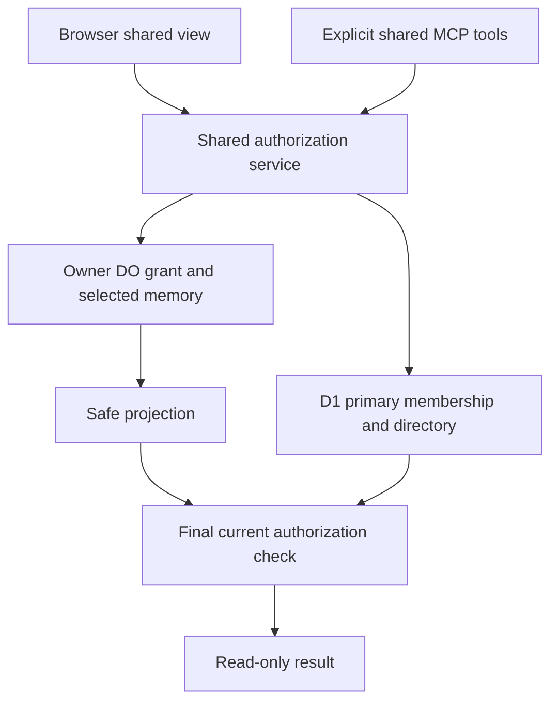
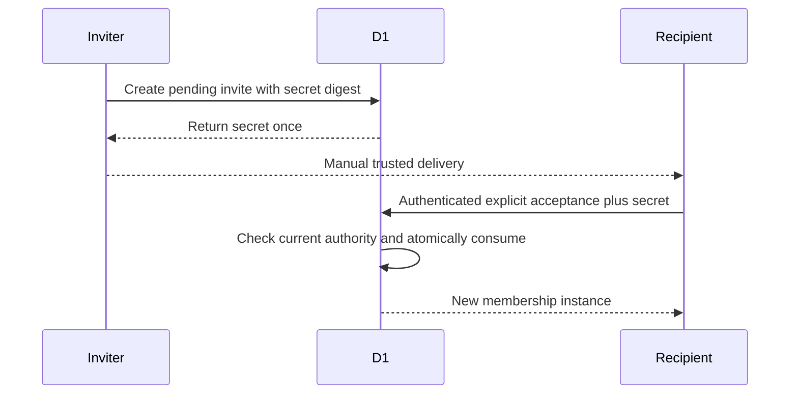
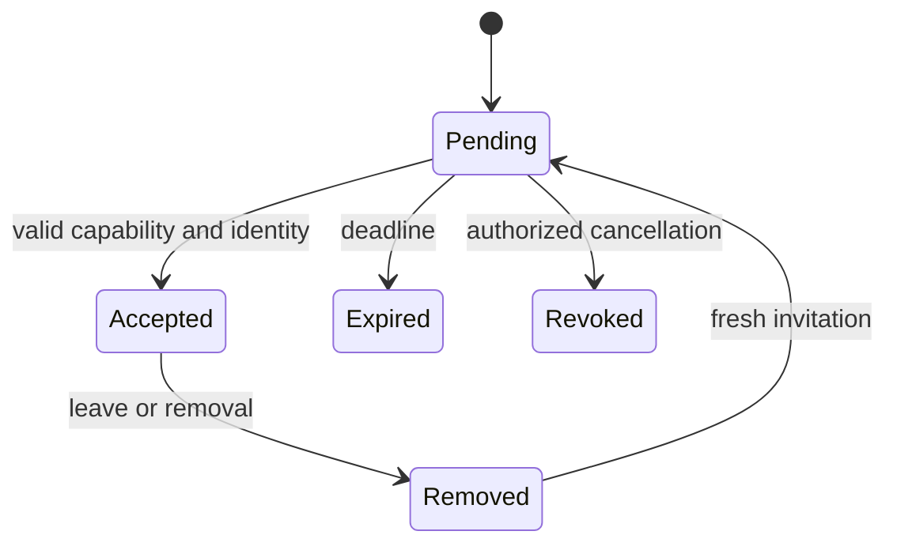
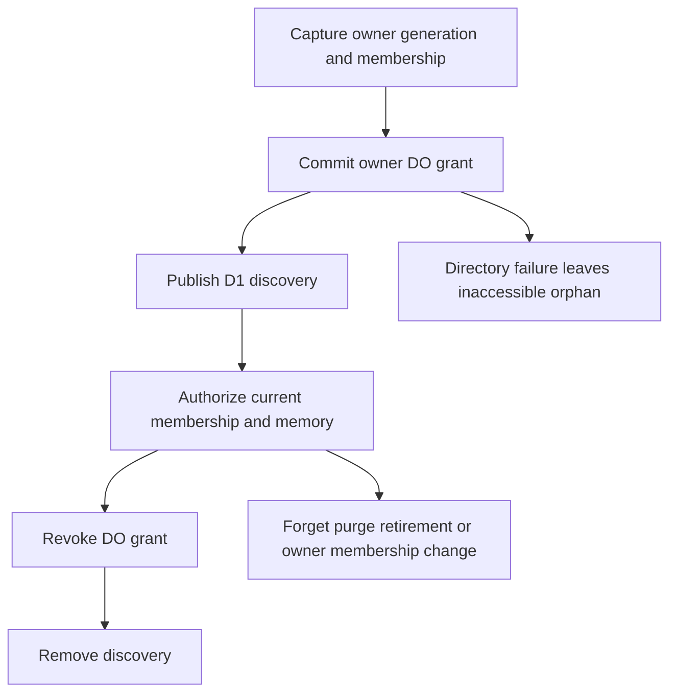
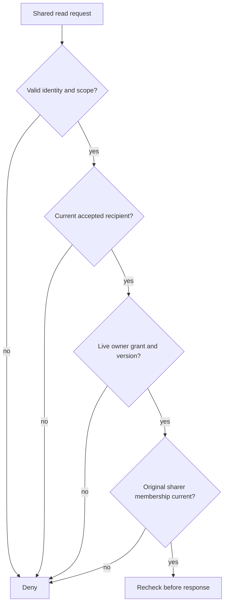

# Team Accounts and Controlled Memory Sharing - Plan

## Goal Capsule

- **Objective:** People can deliberately share selected memories with their team while keeping their other memories private and retaining control of future access.
- **Means:** Existing workspaces become team accounts; accepted membership and owner-controlled read-only references add sharing without moving personal memory graphs (KTD1–KTD4).
- **Authority:** User-authorized scope and Product Contract govern behavior; Planning Contract governs mechanisms; units cannot weaken either.
- **Execution:** Implementation is authorized on the isolated validation branch. Use deterministic negative tests, real local Wrangler integration, independent review, and small coherent commits.
- **Stop conditions:** Do not deploy, migrate production, publish, push, introduce paid resources, send invitations externally, or create OAuth grants without separate authorization. Report evidence that invalidates privacy guarantees instead of weakening tests.
- **Completion owner:** Parent implementation agent integrates and verifies all units. Andrew retains production/release approval.

---

## Product Contract

### Summary

Add team membership and explicit read-only sharing of selected memory versions to existing workspaces. Members use a separate shared view and shared MCP tools. Personal memory APIs retain their current behavior.

### Problem Frame

OpenMemory currently isolates memory by authenticated user. Its workspace records and invitations manage account metadata but do not authorize collaborative retrieval. Reusing those labels as permissions would grant access without recipient acceptance and could expose private graph neighbors or profiles.

### Requirements

**Accounts and membership**

- R1. Reuse `workspace` as the team/account identity; keep each user's private graph separate.
- R2. Membership becomes usable only after authenticated explicit acceptance of a valid invitation capability; existing email matches and legacy non-owner active rows confer no shared-content access.
- R3. Owners manage workspace name, administrators, and members; administrators may invite/remove ordinary members but cannot change owners or administrators, and members may leave.
- R4. Every accepted member can explicitly share their own memories; workspace role never grants access to unshared memory or shared-content editing.

**Sharing and revocation**

- R5. Share only the selected active/latest memory version read-only with the workspace, including future accepted members; new versions do not inherit grants.
- R6. Only the memory owner may revoke their grant; recipients cannot edit, forget, reshare, or export another person's memory through OpenMemory.
- R7. Shared list/read/search return only authorized projected records and cannot disclose private profile, metadata, source, entities, edges, or historical/forgotten content.
- R8. Removal/leave immediately prevents new shared reads by that membership; old shares authored by the departing member remain unusable after rejoin. A rejoining recipient can read currently active workspace-audience shares after fresh acceptance.
- R9. Forget, supersession, purge, retirement, and restore cannot reactivate an old share; delayed requests and partial cleanup fail closed.
- R10. Revocation blocks requests starting after its acknowledged completion; a request paused before its final authorization check is suppressed if the check sees revocation. Previously delivered data or concurrently authorized responses cannot be retracted.

**Interfaces and compatibility**

- R11. Browser/API and explicit shared MCP tools use the same authorization service; MCP requires a new explicit `memory:shared:read` scope and current OAuth grant validity.
- R12. Existing personal read/write scopes, APIs, exports, imports, profiles, and extraction jobs gain no shared authority or copied shared data.
- R13. UI identifies the owner, selected version, workspace audience, read-only access, and revocation/copy limitation before sharing; invitation tokens appear once to the inviter for manual delivery.
- R14. Persist metadata-only grant and membership change audit events; never log invitation secrets, access tokens, or memory content.
- R15. Workspace owners can delete the team after explicit confirmation without deleting any user or personal memory graph; old workspace IDs and shares never become usable again.

### Actors and acceptance examples

A1 is the workspace owner; A2 is an accepted administrator; A3 is an accepted ordinary member and memory owner; A4 is an invite recipient or outsider; A5 is a connected MCP client.

- AE1. Covers R2: An existing account appears in a legacy active membership row. Shared reads remain denied until a fresh valid invitation is explicitly accepted by that account.
- AE2. Covers R4–R7: A3 shares memory X, linked to private memory Y. A2 can retrieve projected X but cannot retrieve Y, the owner's profile, or source metadata, and cannot modify X.
- AE3. Covers R8–R10: Remove A3, accept a new invitation for A3, and replay an old share ID. A3's old authored share remains unavailable; a new explicit share can work.
- AE4. Covers R9: Purge then restore the same memory ID while an old share creation is paused. The old request and grant remain unusable; restored content remains private.
- AE5. Covers R11–R12: An existing valid personal OAuth token cannot call shared tools. Newly consented shared-read access still loses a revoked memory immediately at the authorization boundary.

### Scope Boundaries

Direct-person grants, collaborative editing, ownership transfer, automatic version following, shared graph/profile synthesis, shared Vectorize indexes, shared caches, shared extraction jobs, and recipient exports are deferred. Email delivery is not introduced; the inviter manually sends the secret capability through their chosen channel. No duplicate organization layer, billing, SCIM, SSO, policy engine, or new Cloudflare service is needed.

Distributed transactions spanning D1 and owner Durable Objects are considered and not built: authoritative checks plus monotonic revocation close the exposure risk, while recoverable discovery omissions remain visible. Stronger guarantees covering data already delivered would be impossible and are not promised.

### Source preservation

The upstream team-sharing proposal is narrowed by the authorized implementation brief to workspace-only grants and bounded lexical retrieval. Its private-by-default ownership, acceptance, revocation, audit, OAuth compatibility, and adversarial test requirements remain. Direct-user grants and AI/vector shared retrieval are explicitly deferred.

---

## Planning Contract

### Existing source behavior

At candidate `f8e2820daa83bb4a618ac99a2bf035ac5e22527f`, `apps/api/src/auth.ts` selects the user's named Durable Object. `apps/api/src/account.ts` always resolves the caller's owned workspace, and `inviteWorkspaceMember` immediately activates known emails. `apps/api/src/memory-graph.ts` creates new IDs on update and traverses private graph edges during search. `apps/api/src/recall.ts` can add a full owner profile. `apps/api/src/mcp-scopes.ts` recognizes personal read/write only. These are extension boundaries, not shared-memory implementations.

### Key Technical Decisions

- KTD1. **Extend D1 workspace membership, not tenant routing.** `workspace-access.ts` owns accepted membership and role checks (R1–R4). A membership has a stable instance ID and accepted timestamp; removal terminates that instance and reacceptance creates a new ID. Owner identity comes from `workspace.owner_user_id`, never a mutable member label. Export `getWorkspaceAccess(env, actorId, workspaceId)` returning `{workspaceId,ownerUserId,memberId,role}` or unavailable/denied, requiring a current user and accepted membership. Resolve `ensureOwnerMember` by stable owner ID rather than allowing email-based updates to overwrite identity.
- KTD2. **Capability-bound invitations.** Store only the digest of a cryptographically random 32-byte invitation token, expiration, workspace, normalized target email, intended role, inviter, and prebound user ID when one exists (R2). Require a signed-in matching email plus token and prebound ID match. This supports unverified accounts without treating email registration as proof; possession depends on the inviter's trusted manual delivery. Atomically consume once and create acceptance with current inviter authorization encoded in conditional D1 mutations; a check followed by an unconditional write is insufficient. Never autoaccept via GET or query-string token. Revoke/reissue invalidates the old token.
- KTD3. **Owner DO grants are authoritative.** Each grant binds random share ID, workspace ID, memory ID, tenant generation, and sharer's accepted membership instance ID (R5–R9). Keep grants outside graph export/import. Synchronous SQL checks and writes have no asynchronous gap inside the owner operation. D1 directory contains `share_id`, `owner_user_id`, `workspace_id`, `memory_id`, `created_at`; it is discovery only. A private DO result includes owner membership/generation for service validation, while public projection excludes them.
- KTD4. **One service authorizes all shared reads.** `workspace-sharing.ts` resolves actor identity, reads current recipient and sharer membership, loads the owner grant/current selected memory, and rechecks recipient/sharer membership followed by a final owner-DO grant/generation read before responding (R7–R11). D1 authorization reads use primary database calls, with no replica/TTL permission cache. Separate shared lexical retrieval ranks only this projection; never call personal `MemoryGraph.search`, profile, graph expansion, or semantic retrieval.
- KTD5. **Safe cross-store ordering.** Create the DO grant before directory insertion; if directory insertion fails, return a retryable unavailable result with no success claim and retry the same idempotency identity. Revoke the DO grant before directory cleanup; stale discovery never overrides revocation. New grants must not reuse a revoked share ID. Capture tenant generation before awaits and compare at DO creation; bind membership instance and recheck before publishing discovery. A stale directory entry may remain but cannot restore content access (R9–R10).
- KTD6. **Preserve the OAuth boundary.** Register explicit shared tools and scope alongside personal tools (R11–R12); require it per tool call, including batches, while retaining current token-generation enforcement. All shared REST operations are session-only with no local-header fallback; shared MCP requires verified JWT identity even on localhost. Shared tools require personal `memory:read` plus `memory:shared:read`. Grant creation/revocation and invitation management remain human session actions. Validate supplied Origin against the request/auth base and reject cross-site fetch metadata on mutations, including legacy invite routes; current credential-reflecting CORS is not a CSRF defense. Return private, no-store on all shared responses.
- KTD7. **Additive compatibility.** D1 migration `0006_team_accounts.sql` adds invitation, directory/audit, and acceptance fields. Keep the owner active; invalidate legacy non-owner activation for shared authorization and make old invite routes issue pending capabilities. DO schema initialization adds private grant/audit tables and purge clears them. Do not renumber committed 0004/0005 OAuth migrations (R2, R9, R12).

These choices preserve the existing CF deployment. [D1 primary calls without Sessions](https://developers.cloudflare.com/d1/worker-api/d1-database/) avoid replica lag in authorization. [DO SQLite storage](https://developers.cloudflare.com/durable-objects/api/sqlite-storage-api/) provides transactional storage within each owner; it does not make D1 and DO mutations atomic together. Per-workspace content copies were rejected because deletion and ownership would become harder to enforce; broad owner-graph retrieval was rejected because filtering after expansion is too late. No competing mechanism remains that requires a bake-off.

### API contracts

These paths are the integration agreement; method internals may adapt to existing TypeScript conventions.

| Surface | Request | Result and authority |
|---|---|---|
| GET `/v1/workspaces` | Session | Owned and accepted workspaces, membership ID and role; no invitation tokens |
| GET `/v1/workspaces/:workspaceId/members` | Session | Current roster; ordinary members receive sanitized identity labels, emails restricted to owner/admin |
| DELETE `/v1/workspaces/:workspaceId` | Confirm workspace ID/name | Owner-only deletion of team/members/directory; personal graphs and users untouched |
| POST `/v1/workspaces/:workspaceId/invitations` | `email`, `role` | `invitationId`, one-time `token`, `expiresAt`; permission per R3 |
| POST `/v1/workspace-invitations/:invitationId/accept` | `token` | New accepted membership per KTD2 |
| DELETE `/v1/workspaces/:workspaceId/invitations/:invitationId` | Session | Revoke pending capability; same hierarchy as invitation creation |
| PATCH `/v1/workspaces/:workspaceId/members/:memberId` | `role` | Owner changes member/admin role; cannot modify owner |
| DELETE `/v1/workspaces/:workspaceId/members/:memberId` | Session | Authorized removal or non-owner self-leave |
| POST `/v1/workspaces/:workspaceId/shares` | `memoryId`, request identity | Explicit own-memory grant, `shareId`; actor determines owner graph |
| DELETE `/v1/workspaces/:workspaceId/shares/:shareId` | Session | Own grant revocation, idempotent if already revoked |
| GET `/v1/workspaces/:workspaceId/shares` | `limit`, cursor | Authorized projected page |
| GET `/v1/workspaces/:workspaceId/shares/:shareId` | Session | Authorized projected record or generic not found |
| POST `/v1/workspaces/:workspaceId/search` | `q`, `limit`, cursor | Authorized lexical results and explicit continuation/partial indicator |
| MCP `shared_list`, `shared_read`, `shared_search` | Workspace and relevant read arguments | Same service/projection; `memory:shared:read` required |

Public records contain share ID, workspace ID, stable owner attribution, selected memory ID, content, type, and tags only. Treat the shared reference ID as resource identity, not the raw memory ID. Deny arbitrary owner IDs and `includeHistorical`, `includeForgotten`, profile, graph, or source expansion options. Session endpoints reject missing authentication, unauthorized workspace access, and cross-origin mutations; record lookup denial does not reveal whether another person's memory exists. Permission infrastructure failures return unavailable, not successful empty results.

### High-Level Technical Design

The API table supplies the interface shape; diagrams cover components/data flow, invitation sequencing, membership states, share lifecycle, and authorization decisions.

### Assumptions

Operational defaults to validate during implementation: invitations expire after seven days; each request processes at most 100 directory candidates and returns at most 25 projected records with keyset continuation. Search ranks each authorized page, advertises page-local ranking, and never claims a global best result across unvisited pages. These are resource/UX defaults, not permission shortcuts. No content is dropped silently.

No shared AI context builder is introduced in this increment: clients may use returned authorized shared-search content themselves. Copies already delivered cannot be revoked. Team deletion is separate from account deletion; a later lazily created personal workspace gets a fresh ID. Current owner identity and current sharer membership must still be checked after account deletion, even if directory cleanup fails.

### Sequencing and ownership

U1 and U2 can proceed independently after agreeing data fields. U3 follows their contracts; U4 follows the REST contract. U5 verifies the integrated patch. Parent owns common integration files to prevent overlapping changes. No unit implements a duplicate membership or authorization helper.

---

## Implementation Units

### U1. Accepted workspace membership and invitations

**Goal:** Establish usable team accounts with safe invitation acceptance.

**Requirements:** R1–R4, R8, R14–R15; AE1.

**Dependencies:** None.

**Files:** `apps/api/src/account.ts`, new `apps/api/src/workspace-access.ts`, `apps/api/src/db/schema.ts`, new `apps/api/drizzle/0006_team_accounts.sql`, new `apps/api/test/workspace-access.test.ts`.

**Approach:** Own D1 migration and membership service per KTD1, KTD2, KTD7. Provide parent-facing lookup/create/accept/remove/role functions; keep routing in U3. Include directory table schema agreed with U2/U3. Preserve owned account response compatibility while removing implicit non-owner activation.

**Patterns:** Existing account session resolution and Drizzle schema; existing migration style.

**Execution note:** Begin with denied legacy activation and invitation replay characterization.

**Test scenarios:**

1. Covers AE1: migrate an owner, known-user active member, and invited email; only owner is initially authorized.
2. Valid capability accepts exactly once for the intended account; wrong token, expired token, email mismatch, prebound-ID mismatch and replay fail.
3. Concurrent accept/revoke and two accepts produce at most one valid membership instance.
4. Demoted/removed inviter cannot cause later acceptance with stale authority; owner/admin/member matrix enforces R3.
5. Remove then reinvite creates a new membership ID, while owner cannot remove/demote themselves.
6. Missing D1 or failed transactional update fails closed, with no secret in audit data.
7. Team deletion denies every old share while preserving all users/private graphs; lazy workspace recreation uses a new ID.
8. Legacy invite and owner-repair paths cannot modify owner identity or bypass acceptance.

**Verification:** New service tests plus real migrated D1 acceptance checks in U5 prove behavior, not row-field presence.

### U2. Owner-authoritative selected-version grants

**Goal:** Authorize references without exposing the private graph.

**Requirements:** R4–R10, R12, R14; AE2–AE4.

**Dependencies:** Agreed membership instance contract from U1; implementation can proceed in parallel.

**Files:** `apps/api/src/memory-graph.ts`, new `apps/api/test/shared-grants.integration.test.ts`, dedicated test fixture under `apps/api/test/fixtures/`.

**Approach:** Add create/read/revoke grant operations per KTD3 and KTD5. Private RPC results carry share lifecycle bindings for service checks; public safe projection is explicit. Keep grant mutation and visibility checks synchronous in the owner DO. Integrate schema initialization, forget/update visibility, purge/retire, and export/import exclusions.

**Patterns:** Existing ingestion-generation fencing and real local DO fixture.

**Test scenarios:**

1. Covers AE2: selected own active memory can be shared; projection excludes metadata, sources, entities, edges and profile.
2. Forgotten, superseded, invalid, and stale-generation memory share creation/read fail.
3. Covers AE4: pause before creation, purge/restore the same memory ID, resume; old generation fails and exports/imports contain no grants.
4. Revoke then repeat create/retry cannot revive the old share ID; new explicit intent obtains a new grant identity.
5. Purge/retirement prevents late grant reads and writes; tenant B's records remain unchanged.

**Verification:** Real owner DO SQLite tests demonstrate grant and memory lifecycle checks together.

### U3. Shared service, REST, and MCP integration

**Goal:** Expose shared access consistently without widening personal APIs.

**Requirements:** R4–R12, R14–R15; AE2–AE5.

**Dependencies:** U1, U2.

**Files:** New `apps/api/src/workspace-sharing.ts`, `apps/api/src/index.ts`, `apps/api/src/mcp.ts`, `apps/api/src/mcp-scopes.ts`, `apps/api/src/better-auth.ts`, `packages/client/src/index.ts`, new `apps/api/test/workspace-sharing.test.ts`, `apps/api/test/mcp-scope.test.ts`, `packages/client/src/index.test.ts`.

**Approach:** Parent exclusively owns these integration files. Implement the API table and service per KTD4–KTD6, with bounded authorized lexical ranking and current-member rechecks. Old account invitations route through the safe service; do not retain an alternate autoactivation path. Expose client methods without changing defaults of personal calls.

**Patterns:** Existing session and MCP authentication, typed client request handling, current OAuth generation checks.

**Test scenarios:**

1. A shares X to team T; B accepted in T reads it through every explicit shared surface; outsider C and forged owner/tenant headers fail.
2. Covers AE3: original sharer membership disappears and rejoin gets new ID; old grants fail even while recipient membership remains valid.
3. Pause list/read/search before final check, revoke/remove, resume; no content appears after the observed revocation.
4. Directory failure, stale rows, missing owner, failed membership lookup and duplicate creation retries never broaden access.
5. Covers AE5: personal-only token denied on shared tools, mixed MCP batch requires both applicable scopes, revoked OAuth grant remains denied.
6. Pagination validates cursor ownership/workspace and bounds work; no unauthorized content enters lexical ranking or returned counts.

**Verification:** Service boundary tests and local HTTP/MCP integration show the same decisions on each interface.

### U4. Team controls and explicit sharing UI

**Goal:** Let users invite, accept, share, inspect, and revoke without confusing team and private data.

**Requirements:** R1–R8, R13, R15.

**Dependencies:** U3 API/client contracts.

**Files:** `apps/web/src/admin-components.tsx`, `apps/web/src/routes/index.tsx`, `apps/web/src/dashboard-model.ts`, new shared/team components as needed, `apps/web/src/dashboard-model.test.ts`, new `apps/web/e2e/team-sharing.spec.ts`.

**Approach:** Use existing dashboard/account patterns. Provide team selection for shared views without switching personal tenant. Present invitation secret once with manual copy; authenticated recipient enters invitation ID/token and explicitly accepts. Show owner and selected-version sharing state and read-only controls; clear stale visible shared results on denial or workspace switch.

**Patterns:** Existing account forms, typed client and local Playwright setup.

**Test scenarios:**

1. Owner creates invite and sees copyable secret once; subsequent roster refresh does not reveal it.
2. Recipient signs in, explicitly accepts, and sees shared X but never private Y.
3. Member shares own selected version and revokes it; teammate cannot invoke edit/delete controls or forge requests successfully.
4. Role denial, expired token and unavailable service produce actionable states without rendering stale authorized content as current.
5. Switching workspace changes only the shared view; personal memories and tenant stay unchanged.
6. Team deletion requires owner confirmation and preserves personal memory; account deletion remains a distinct action.

**Verification:** Real local browser flow with isolated users and API-backed permissions, plus model tests for view-state reset.

### U5. Adversarial qualification and rollout documentation

**Goal:** Demonstrate the intended boundary and preserve honest release evidence.

**Requirements:** R1–R15; AE1–AE5.

**Dependencies:** U1–U4.

**Files:** `apps/api/test/http.integration.test.ts`, new shared HTTP integration file if fixture reuse warrants it, `apps/web/e2e/team-sharing.spec.ts`, `docs/validation-2026-10-17.md`, `README.md`.

**Approach:** Add real two/three-user sessions and PKCE scope flows; deterministic barriers isolate revoke, membership change, purge and late completion. Retain initial failing evidence. Independent review covers the cumulative patch and migration, not only helper tests. Document local-versus-live coverage and actual API limitations.

**Patterns:** Existing real PKCE/D1 and ingestion fence tests.

**Test scenarios:**

1. Covers AE1–AE5 across actual HTTP and MCP with real local D1/DO state.
2. Account deletion, workspace-owner deletion, sharer removal, recipient removal and same-ID restore each remove only the intended access.
3. Existing personal CRUD/search/export/import and OAuth generation tests continue to pass without shared data contamination.
4. Fresh and legacy database migrations produce equivalent secure membership semantics; no restored grants or old accepted flags bypass capability acceptance.

**Verification:** All applicable gates below pass, findings are resolved, and evidence names the actual tested commit and remaining live uncertainties.

---

## Verification Contract

Use the repository's local test entry points: `bun run check-types`, `bun run test`, `bun run test:integration:local`, `bun run test:mcp:sdk`, and `bun run test:e2e:local`. Add focused Vitest paths for the new units before broad checks. The current `release:validate` includes formatting, checks, build, SDK smoke, local integration/browser tests and recall/scale benchmarks; run when the final cumulative candidate is ready and machine contention allows. It does not establish real vendor or production RAG evidence.

Do not run tests against hosted production or use Miradita's device/test resources. Use disposable local storage and available SSD artifacts, serialize heavy builds, and stop only the servers this task started. Every security test must assert both authorized success and unauthorized failure; inspect projected payloads and provider-call inputs rather than relying on HTTP status alone. Distinguish real local SQLite/D1 coverage from mocked failure barriers and live Cloudflare behavior.

---

## Definition of Done

Each unit satisfies its cited requirements and behavioral tests. The integrated patch preserves personal isolation, adds only explicit sharing, passes the local verification contract, and has no unresolved blocking independent-review findings. Remove abandoned experiments and duplicate helpers. Evidence records exact candidate commit, commands, results, migration requirements, and the rollback boundary.

Production remains a separate gate: apply reviewed additive migration before compatible code, verify deployed bindings and real vendor shared-scope consent with approved disposable accounts, and refresh release/RAG evidence. Roll back by disabling shared interfaces or a compatible roll-forward; do not deploy old code that reactivates legacy memberships or ignores OAuth/tenant-generation retirement. No local result authorizes publication or production changes.
