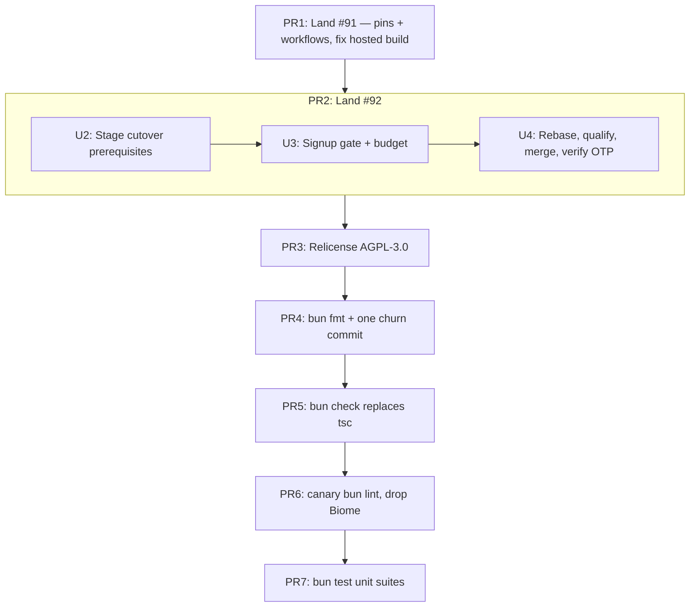

# Finish OpenMemory Phase 1 - Plan

## Goal Capsule

- **Objective:** `main` on andrew-bierman/openmemory is healthy and shippable: both open PRs are merged, signup posture is operator-controlled, the project is relicensed AGPL-3.0, and Biome/tsc/the unit-test runner are replaced by Bun-native tools — with functional changes never mixed into formatting churn and no lost test coverage.
- **Means:** Land PR #91, land PR #92 (rebased, with the signup gate and cutover prerequisites inside its landing) using merge-first cutover, relicense, then migrate the toolchain in four incremental PRs. (KTD1)
- **Product authority:** Andrew Bierman (sole author and operator of the hosted deployment).
- **Execution profile:** Seven PRs chained in merge order (PR1–PR7 below); sized so one agent can carry it end-to-end. `main` is green (CI + hosted Workers Build) at every merge boundary.
- **Open blockers:** None. Resend credentials are needed during PR2 execution and are recorded as a dependency, not a blocker.
- **Who finishes the work:** Implementation follows this artifact; the shipping pipeline owns commit, PR, and CI watch.

**Product Contract preservation:** restructured, no scope change — R7 mechanism amended at plan time per user decision (mapping then one isolated churn commit); R10 narrowed per user decision (Wrangler integration suite stays on Vitest); R11 mechanism refined (canary isolated to the lint job); R3/R4 unchanged in intent with mechanism detail moved to KTD2/KTD3.

---

## Product Contract

### Summary

Land the two open PRs, make the auth posture a single operator-controlled setting, switch the license to AGPL-3.0, and move formatting, type checking, lint, and unit tests onto Bun-native tools — in that order, keeping `main` green at each step.

### Problem Frame

The launch-readiness checklist defines what "finished" means, and `main` does not yet meet its own floor. PR #91 (Node 24.22.1 / Bun 1.4.4 alignment) is ready but its hosted Workers Build fails. PR #92 (invitation-only passwordless accounts plus read-only team sharing) is fully qualified locally but sits undeployed on a 12,210-line branch. The dev loop pays four tools — Biome, tsc, Vitest, and the script layer around them — where Bun 1.4 ships native replacements in one binary. A public fork (austinlaw076) already runs its own production deployment from a patch stack that includes a signup gate, showing self-hosters need operator-controlled posture rather than hard-coded behavior.

### Requirements

**PR landings**

- R1. PR #91 is merged into `main` with its hosted Workers Build failure diagnosed and fixed; CI and the hosted build are green after merge.
- R2. PR #92 is rebased onto post-#91 `main`, merged, and passes its own local qualification (full check including the TypeScript suite, browser cases, and recall/scale gates) under the conflicts the rebase introduces. (Repo research shows the rebase is textually conflict-free: #92 touches zero workflow/Dockerfile/root-package.json files.)

**Auth posture and cutover**

- R3. Signup posture is operator-controlled by one config setting: the default is invite-only, and a self-hoster can flip a single setting to open passwordless registration (adapting the fork's gate pattern to PR #92's passwordless flow).
- R4. The hosted deployment completes the passwordless cutover immediately after #92 merges: Resend secrets plus sender/domain configured and a real inbox OTP receive verified. The merge-first ordering accepts a temporary existing-user lockout window before this is done.
- R5. The password-login removal is announced as part of the merge work: README auth section, a discussions post, and a changelog entry — including the note that live MCP client token refresh breaks for non-allowlisted users at cutover.

**License**

- R6. Upstream relicenses to AGPL-3.0: the `LICENSE` file is replaced, MIT references in README, CONTRIBUTING, `docs/roadmap.md`, and the root `package.json` license field are updated, CONTRIBUTING gains the inbound AGPL contribution grant, and the README states that fork snapshots taken under MIT keep their MIT rights.

**Bun-native toolchain**

- R7. Formatting runs `bun fmt`, with `bun fmt --check` green in CI. Style is mapped from `biome.json` into Bun's config to minimize the diff, and the unavoidable residue lands as one isolated format-only commit — functional changes never mix into it.
- R8. Type checking runs `bun check`, replacing the tsc-via-Turbo path, with failure detection at least equal to today's across all typechecked tsconfigs (root src, tests, and the auth-email package when present).
- R9. Linting runs `bun lint` on a canary-pinned Bun in an enforcing CI job, with the Biome ruleset hand-translated so pre-existing findings carry over rather than silently disappearing; new canary findings are triaged, not blanket-suppressed.
- R10. Unit test suites run under `bun test`, with every assertion ported — none weakened or dropped. The Wrangler child-process integration suite stays on Vitest unchanged.
- R11. Toolchain pins keep stable Bun 1.4.4 as the default channel everywhere they exist today (`.tool-versions`, `packageManager`, `Dockerfile.test`, CI setup steps); the lint job alone pins an exact canary build through a separate pin source that production deploys never read.

### Key Decisions

- KD1. Land PRs before migrating tooling, in small incremental steps. Governs R1, R2, R7–R11. (session-settled: user-directed — chosen over Bun-first and single-flip sequencings: `main` stays shippable at every step and each migration step is independently revertable.)
- KD2. PR #92 ships as designed: invitation-only passwordless accounts, password APIs removed, social OAuth stays optional. Governs R3. (session-settled: user-approved — proposed with the no-open-signup tradeoff surfaced; user assented.)
- KD3. Cutover is merge-first, verify-OTP-after: deploy prerequisites stage before the merge, the real-inbox OTP proof happens after it. Governs R2, R4, R5. (session-settled: user-directed — chosen over prove-OTP-first and pause-auto-deploy: the lockout window is accepted knowingly. Conflict call-out from plan research: the blast radius includes live MCP client token refresh for non-allowlisted users, larger than the "just your own account" framing the decision was made under — proceeded as settled with this flag recorded.)
- KD4. The toolchain goes Bun-native for formatting, type checking, lint, and unit tests; the Wrangler integration suite remains on Vitest. Governs R7–R10. (session-settled: user-directed — chosen over the stable-toolchain subset and over migrating the integration suite: the motivation was replacing Biome, and the CF-native stack keeps its first-party integration runner. Amended at plan time, user-approved: integration suite stays on Vitest per real-world hang evidence.)
- KD5. Signup posture becomes operator config as part of landing #92, not a follow-up. Governs R3. (session-settled: user-directed — user proposed config-gating for fork ease; the requalification cost under both gate states was surfaced and accepted.)
- KD6. The project relicenses from MIT to AGPL-3.0. Governs R6. (session-settled: user-directed — chosen over keeping MIT and dual-licensing: forks must share their changes back, including when they only host; the adoption-chill tradeoff was surfaced and accepted.)
- KD7. Fork feature harvesting (Gemini extraction fallbacks, bge reranker, API-token auth channel, MCP read-only annotations) is deferred to the launch-gate area, where it feeds the RAG production review. No Governs links; see Scope Boundaries.

<!-- ce-section: work-relationships -->
### How This Work Fits Together

This plan owns Phase 1 only: a healthy, AGPL-licensed, Bun-native `main` with operator-controlled auth. The broader breakdown below is the current understanding, not a committed roadmap.

- **Launch path** — Depends on this plan's healthy `main`. Carries the three strict launch gates (Cursor/Claude/ChatGPT MCP dogfooding, social OAuth evidence, RAG production review), the launch announcement, and the release tag. Also inherits KD7's deferred fork features into its RAG review. The user has committed this as the immediate next area.
- **Product polish** — Onboarding and dashboard navigation work from alpha feedback. Can proceed independently of the launch path's gates; the user ordered it third. Still to decide: which polish items graduate into a plan.

### Actors

- A1. Operator — Andrew for the hosted deployment, or a self-hoster; controls config and secrets.
- A2. Invitee — a new user redeeming an invite, or self-registering when the gate is open.
- A3. Existing user — a pre-merge account holder who must move to passwordless.
- A4. Fork maintainer — a self-hoster tracking upstream (the austinlaw076 case), who may open registration on their deployment.

### Key Flows

- F1. Passwordless cutover
  - **Trigger:** PR #92 merges to `main`.
  - **Actors:** A1, A3, A4.
  - **Steps:** Cutover prerequisites staged (auth-email worker deployed, `AUTH_EMAIL` binding in root config, D1 migrations applied, Resend secrets set, budget enabled, inventory and D1 backup recorded) → Workers Builds auto-deploys `main` → password login and open signup turn off → every pre-deploy MCP token fails closed on its next request (0005 grant binding), so each client re-authorizes once via OTP plus consent; non-allowlisted principals cannot → existing dashboard sessions persist until natural expiry → A1 verifies a real inbox OTP receive → invite flow confirmed working.
  - **Outcome:** Hosted auth is fully passwordless; the operator's lockout window closes when R4 completes, and other users return through the invite flow as the operator widens the recipient allowlists (invite-only by design).
  - **Covers R2, R4, R5**
- F2. Operator opens registration
  - **Trigger:** A1 sets the signup gate to open on their deployment.
  - **Actors:** A1, A2.
  - **Steps:** Config set (exact-`true` parsing) → deployment picks up the setting → registration accepts passwordless signup without an invite, bounded by the per-email throttle and production send budget.
  - **Outcome:** A fork or self-hosted deployment runs open registration; the hosted deployment stays invite-only by default.
  - **Covers R3**

### Acceptance Examples

- AE1. Gate closed (default)
  - **Covers R3.**
  - **Given:** Default config on any deployment.
  - **When:** An uninvited visitor attempts to register.
  - **Then:** Signup is rejected; only invite redemption creates accounts.
- AE2. Gate open
  - **Covers R3.**
  - **Given:** The operator has set the gate to open.
  - **When:** A visitor registers with an email address.
  - **Then:** They receive a 6-digit OTP by email and activate the account without any invite.

### Success Criteria

- After every landing step: CI green, hosted Workers Build green, and `bun run release:validate` passing locally.
- The auth qualification suite passes under both gate states (invite-only default, open registration).
- `bun fmt --check`, the canary `bun lint` job, `bun check`, and `bun test` unit suites are green in CI.
- The toolchain migration introduces no churn beyond intentional edits, per R7 and R10: formatting churn confined to one isolated commit, no dropped or weakened assertions, and the wrangler suite untouched.
- License consistency: no stray MIT references remain in README, CONTRIBUTING, `docs/roadmap.md`, or workspace metadata, and CONTRIBUTING carries the inbound AGPL grant.

### Scope Boundaries

**Deferred for later**

- The launch path: MCP vendor dogfooding for Cursor, Claude, and ChatGPT; social OAuth evidence; semantic RAG trace and rerank threshold review; launch announcement; release tag.
- Fork feature harvesting: Gemini extraction with free fallbacks, dedicated bge reranker, API-token auth channel, MCP read-only annotations (KD7).
- Open signup as the default posture: the default stays invite-only; openness is an operator choice (R3).

**Outside this work's identity**

- Making everything configurable: only signup posture graduates to operator config; rerank model, extraction providers, and social-OAuth enablement are already config-driven today.
- Removing Turbo: it stays as the task orchestrator.
- New product features.
- OTP delivery-failure alerting: the existing `auth_email_delivery_failed` log is the observability floor — a missing OTP is user-visible to its recipient and lands in that log, and wiring alerts is cheap ops config to add when the recipient list grows beyond the operator.

### Dependencies / Assumptions

- Andrew supplies Resend credentials (account, sender domain, API key) during PR2 execution so R4 can complete; the human step is the operator's.
- Relicensing is unencumbered: all merged upstream commits are authored by andrew-bierman (verified across PR history), so AGPL-3.0 applies to new versions; fork snapshots keep MIT.
- A canary Bun build shipping `bun lint` remains available as an exact-pinned npm dist-tag; `setup-bun`'s canary support is verified at execution time (execution-time discovery, KTD8).
- PR #91's hosted Workers Build failure has a diagnosable cause in repo-config or deploy settings; if it proves Cloudflare-side, the diagnosis and escalation are documented in the PR (execution-time discovery).

### Outstanding Questions

**Resolve Before Planning**

None.

**Deferred to Planning / implementation-time discovery**

- Exact canary version-pin mechanics for the lint job (KTD8).
- Root cause and fix for PR #91's hosted Workers Build failure (U1; diagnosis documented in the PR).
- Conflict-resolution specifics if the #92 rebase surfaces surprises beyond the researched textual conflict-free state (U4).

### Sources / Research

- Grounding dossier: `/tmp/compound-engineering-1000/ce-brainstorm/openmemory-finish-20261119/grounding.md` (machine-local, best effort; verified quotes with `file:line` pointers — not a blocker if missing; this artifact's requirements govern any disagreement).
- Plan research dossiers: `/tmp/compound-engineering-1000/ce-plan-research/7c1ffd13/` — `repo-research.md` (gate location, env pattern, rebase analysis, license sweep, test inventory), `framework-docs.md` (bun fmt/lint/check/test version facts and pitfalls), `best-practices.md` (migration patterns, canary pinning, equivalence gates), `spec-flow.md` (cutover/gate/pin/relicense edge cases). Machine-local, best effort.
- PR #91: https://github.com/andrew-bierman/openmemory/pull/91 — pins Node 24.22.1 / Bun 1.4.4 across 9 workflow files, `.tool-versions`, `Dockerfile.test`, `packageManager`; PR body reports hosted "Workers Builds: openmemory-api" failure.
- PR #92: https://github.com/andrew-bierman/openmemory/pull/92 — 88 files, 12,210 insertions; carries `docs/plans/2026-10-17-010-team-accounts-plan.md` (requirements R1–R15), D1 migrations through `0007_passwordless.sql`, the Resend OTP sender (`apps/auth-email/src/worker.ts`), and its cloud-qualification evidence.
- Fork: https://github.com/austinlaw076/openmemory branch `austin-production` — 9 commits ahead: signup gate, Gemini + free-fallback extraction, bge reranker, API-token auth, MCP read-only annotations, OAuth redirect fix, own deployment config.
- Bun capability facts (verified 2026-11-19): `bun fmt` stable since 1.4.4; `bun lint` canary-only in stable 1.4.4 (on stable it silently falls through to a package.json `lint` script); `bun check` since 1.4.3; `bun test` treats `"vitest"` imports as a built-in module with Vitest semantics.
- Launch-gate artifacts: `config/mcp-vendor-dogfood.json`, `config/social-oauth-dogfood.json`, `config/rag-production-review.json`, `docs/launch-readiness.md` (four unchecked items define the launch path).

---

## Deferred / Open Questions

Entries below are review items left for the author and do not block implementation.

### From 2026-11-20 review

- **Recipient-posture mechanics for the hosted deployment** — U2/KTD2/U3 (P1, coherence, confidence 100)

  Once PR2 deploys, every existing user except the operator is locked out of the OTP path until the operator widens the recipient allowlists; under the invite-only default that is permanent-by-design rather than a window, and the plan records operator-managed config as the smallest mechanism consistent with the settled contract. The alternative — invite acceptance auto-widening both allowlists — is new code in the invite flow.
  Change: if invite acceptance should auto-add the invitee's email to both allowlists, extend U3's recipient-gating work to write through on acceptance; otherwise the operator-managed default stands.

---

## Planning Contract

### Key Technical Decisions

- KTD1. Seven PRs chained in merge order: PR1 lands #91; PR2 lands #92 (prerequisites, gate, rebase/merge); PR3 relicenses; PR4–PR7 adopt bun fmt, bun check, canary bun lint, and bun test unit suites respectively. Each PR keeps `main` green and is independently revertable. Cites KD1. Governs R1, R2, R6–R11.
- KTD2. The signup gate is `OPENMEMORY_ALLOW_SIGN_UP` read through the repo's `env.ts` optional-string pattern with exact-`"true"` parsing (the repo's boolean convention `!== "false"` is default-ON — opposite polarity to the invite-only default this gate needs), wired through every enforcement point #92 adds: the `passwordlessGuard` path block in `apps/api/src/passwordless.ts`, the user-creation hook, the social and emailOTP `disableSignUp` flags, and the auth-email recipient gating. In invite-only mode the recipient allowlists gate who can receive OTPs (operator-managed config; see U2); opening the gate overrides recipient restriction for signup OTPs, bounded by the send budget and the existing per-email/IP throttles. The send budget requires production-mode enforcement — the worker's D1 budget reservation currently runs only in `AUTH_EMAIL_MODE=staging`, so U3 extends budget enforcement outside the staging branch before the open-gate abuse bound holds. Cites KD5, R3.
- KTD3. Cutover prerequisites stage before PR2 merges because #92 disables password login unconditionally and Workers Builds deploys on push: the auth-email worker deployed (its own `0001_send_budget` migration, a production send budget, Resend secrets) with the `AUTH_EMAIL` service binding present in root `wrangler.jsonc`, D1 migrations 0004–0007 applied, both allowlists (`OPENMEMORY_AUTH_ALLOWED_EMAILS` on the API and `AUTH_EMAIL_ALLOWED_RECIPIENTS` on the auth-email worker) containing the operator's email, and the existing `auth_email_delivery_failed` log retained as the observability floor (an allowlist mismatch is visible only through that log today; delivery-failure alerting is recorded as considered-and-not-built). The MCP breakage model: migration 0005's grant binding fails closed every pre-deploy MCP token — access and refresh, allowlisted or not — on its next request, so all live MCP clients re-authorize once via OTP plus consent; allowlisted principals recover, non-allowlisted principals cannot. Existing dashboard sessions persist until natural expiry, and unverified users self-heal by OTP sign-in, which flips `emailVerified`. The merge itself stays ungated on real-inbox proof; that verification is the first post-merge step. Cites KD3, R2, R4, R5.
- KTD4. Formatter swap: translate `biome.json` style into `bunfig.toml [fmt]` (Biome defaults to tabs; bun fmt to spaces — byte-parity is impossible), verify with `bun fmt --check`, then land the residue as one isolated format-only commit before any functional change rides the same PR. Cites KD4, R7.
- KTD5. Typechecker swap: `bun check` uses TypeScript-7 semantics regardless of installed TS (strict by default, `types: []` default, `baseUrl`/`moduleResolution: node`/`es5` removed), so every typechecked tsconfig is audited first — tsc actually runs from five workspace `check-types` scripts (`apps/api` covering three tsconfigs; `apps/web`, `packages/client`, `packages/core`, `packages/ui` one each), not from `turbo.json`. The `"check"` script is renamed out of the way because `bun check` executes a package.json `check` script instead of typechecking when one exists. The Turbo `check-types` task's `dependsOn: ["^check-types"]` is re-derived under `bun check` (no `.tsbuildinfo`/emit makes the build-order dependency unnecessary), and tsc is retained only if a `.d.ts` emit need survives the audit. An equivalence gate compares `bun check` findings against today's tsc findings, matched by `file:line`, before CI switches over. Cites KD4, R8.
- KTD6. Lint swap: `bun lint` reads ESLint/oxlint configs and `bunfig [lint.rules]`, never `biome.json`, and exists only on canary — so the Biome ruleset is hand-translated into Bun's config, the canary Bun is pinned to one exact resolved version in a lint-job-only pin source (never the root pins that production deploys read), the job enforces exit codes, and the pin is re-pinned reactively when the enforcing job reports canary breakage or new rule coverage is needed — no scheduled re-pin or soak cadence, since an exact pin cannot silently acquire upstream breakage and the enforcing job is the detector. Biome is removed from dependencies when its last consumer (lint) migrates. Cites KD4, R9, R11.
- KTD7. Unit test port: `bun test` treats `"vitest"` imports as a built-in module with Vitest semantics, so test files port without rewriting imports; a dual-runner equivalence gate gates the script switch, compared per test name (equal totals can mask different failures). On the tree PR7 ports (post-#92), the Vitest-specific surface is 88 `vi.fn` uses, ~5 `vi.useFakeTimers()`, and ~6 `vi.mock` module mocks (including one async `importOriginal` pattern); suites using `vi.mock` or fake timers state their disposition explicitly — rewrite to bun-native equivalents, run under a canary pin per KTD8, or remain on Vitest. Every workspace `--passWithNoTests` flag (`packages/ui` has zero test files) and the `-t` regex filter scripts (`test:benchmark`, `test:scale`) are mapped. The Wrangler integration suite stays on Vitest untouched, which requires splitting the shared test invocation so the unit switch cannot pull `*.integration.test.ts` and `live.e2e.test.ts` under bun. Cites KD4, R10.
- KTD8. Pin policy: stable Bun 1.4.4 stays the default channel everywhere (setup-bun reads version files; exact pins, hash-cached binaries); canary exists only in the lint job with an exact resolved version string, re-pinned reactively. `setup-bun` canary support is verified at execution time before PR6 depends on it. Cites KD4, R11.

### Assumptions

- Workers Builds deploys `main` automatically from root `wrangler.jsonc` (documented in `docs/deployment.md`; the push trigger lives in the dashboard-connected config, not the repo).
- The #92 rebase is textually conflict-free (repo research: zero shared files between the branches' diffs beyond semantics).
- Stable `bun test` 1.4.4 supports the unit suites' `vi.fn` usage; if execution finds otherwise, the unit PR pins the canary build under KTD8's discipline instead.

---

## Implementation Units

### PR1: Land Node/Bun runtime alignment

Waits on: nothing.

### U1. Merge PR #91 and restore the hosted build

- **Goal:** `main` pins Node 24.22.1 / Bun 1.4.4 everywhere and the hosted Workers Build is green again.
- **Requirements:** R1. Cites KD1.
- **Dependencies:** none.
- **Files:** the PR #91 branch (`.tool-versions`, `Dockerfile.test`, root `package.json`, `.github/workflows/ci.yml` plus the eight other workflow files it already updates); any fix files the hosted-build diagnosis requires.
- **Approach:** Rebase/merge the existing reviewed PR rather than recreating it. Reproduce the hosted failure from its build output; the failure is a Cloudflare Workers Builds run of root `wrangler.jsonc`, so the diagnosis starts from that build log, not local CI. If the cause is Cloudflare-side, document the escalation in the PR instead of patching blind.
- **Test expectation: none** — runtime pin alignment is config and CI; behavior is verified by the suites below.
- **Verification:** Local `bun run check` and `bun run test:integration:local` on the merged `main`; CI green; the hosted Workers Build run for the merge commit green.

### PR2: Land #92 — passwordless, sharing, gate

Waits on: PR1 (merge order plus substance: the rebase target is post-#91 `main`).

### U2. Stage cutover prerequisites

- **Goal:** Production can accept the passwordless deployment the moment PR2 merges: auth-email worker live, migrations applied, secrets present, budget enforced, failures observable.
- **Requirements:** R4 (precondition); R5 (breakage inventory for the announce). Cites KD3, KTD3.
- **Dependencies:** none within PR2; PR1 merged.
- **Files:** a real production auth-email config authored from the branch's `apps/auth-email/wrangler.example.jsonc` template (the branch ships only the template; its README forbids deploying it as-is), root `wrangler.jsonc` (the `AUTH_EMAIL` services binding — the only config file the merge deploy reads), `apps/api/drizzle/0004*`–`0007_passwordless.sql` applied to production D1, `wrangler.maintenance.jsonc` (from #92) for the ops path.
- **Approach:** Deploy the auth-email worker first (send-budget D1 and migrations, production send budget, `RESEND_API_KEY`, sender/domain secrets), then add `services: [{ binding: "AUTH_EMAIL", service: <auth-email-worker> }]` to root `wrangler.jsonc` — the binding requires the target worker to exist, and without it every OTP send throws SERVICE_UNAVAILABLE at merge. Apply D1 migrations 0004–0007 (verify whether any earlier 0006 was applied before using its revised form, per the branch's qualification doc). Put the operator's email in both allowlists — the API's `OPENMEMORY_AUTH_ALLOWED_EMAILS` and the auth-email worker's `AUTH_EMAIL_ALLOWED_RECIPIENTS`; under the invite-only default these lists are operator-managed config, and a user gains the OTP path when the operator adds their email (invite acceptance does not auto-widen them — the worker refuses non-allowlisted recipients in every mode). Record the email/verification inventory and take a D1 backup — both are cutover prerequisites in the branch's own rollout doc. Inventory live MCP OAuth clients so the announce names what breaks.
- **Test scenarios:**
  - Staging rehearsal passes `scripts/staging-qualification.ts` end-to-end and sends a real OTP through the deployed `AUTH_EMAIL` binding — a rehearsal that stubs the binding masks the exact gap this unit exists to close.
- **Verification:** Rehearsal evidence recorded; both allowlists verified for the operator's email; budget configured; email/verification inventory and D1 backup recorded.

### U3. Implement the signup gate and its abuse guard

- **Goal:** `OPENMEMORY_ALLOW_SIGN_UP` controls open registration with invite-only as the safe default.
- **Requirements:** R3. Realizes F2. Cites KD5, KTD2.
- **Dependencies:** U2 (budget exists to bound an open gate).
- **Files:** `apps/api/src/env.ts` (flag parsing), `apps/api/src/passwordless.ts` (path guard, `disableSignUp` wiring), the Better Auth user-creation hook and social/emailOTP config in `apps/api/src/better-auth.ts`, `apps/auth-email/` recipient gating, new tests beside `apps/api/test/`, and a Playwright spec beside `apps/web/e2e/` (the branch's established browser-facing pattern).
- **Approach:** Parse the flag with exact-`"true"` semantics (reject the repo's `!== "false"` polarity — that convention is default-ON). Wire the flag through all enforcement points from KTD2 so no signup path bypasses the gate. In open-gate mode the recipient allowlists stop bounding signup OTPs, so extend the auth-email send-budget enforcement to production mode (`AUTH_EMAIL_MODE` handling in `apps/auth-email/src/worker.ts` — the budget reservation currently lives only in the staging branch); the existing 3-per-email and 10-per-IP throttles stay active in both gate states.
- **Test scenarios:**
  - Covers AE1. Flag unset (default): uninvited `/sign-up/email` attempt is rejected; invite redemption still creates accounts.
  - Covers AE2. Flag exactly `"true"`: visitor registers with an email, receives a 6-digit OTP, activates without an invite.
  - Flag set to truthy-but-not-exact values (`"1"`, `"yes"`, `"false"`): gate stays closed (polarity guard).
  - Gate open: the 4th OTP request for one email within 15 minutes is throttled; the send budget stops delivery when exhausted.
  - Gate state change: a live session on a deployment that flips the gate behaves per the new state on next auth action.
  - Covers AE2. Browser (Playwright, per AGENTS.md browser-facing convention): gate open shows the registration path and completes passwordless signup end-to-end; gate closed hides signup entry points.
- **Verification:** Auth qualification suite passes under both gate states; the new gate tests pass under `vitest run` locally.

### U4. Rebase, qualify, and merge #92; verify OTP after

- **Goal:** #92 is on `main` with the gate; the hosted deployment is passwordless and the operator has received a real OTP.
- **Requirements:** R2, R4, R5. Realizes F1. Cites KD2, KD3, KTD1, KTD3.
- **Dependencies:** U2, U3 complete on the branch; PR1 merged.
- **Files:** the #92 branch (88-file diff, `docs/plans/2026-10-17-010-team-accounts-plan.md` carried); README auth section, `CHANGELOG.md`, the discussions post draft.
- **Approach:** Rebase onto post-#91 `main` (researched textually conflict-free; if surprises surface, resolve and record them). Run the branch's full local qualification — full check with the TypeScript suite, browser cases, recall/scale gates — plus the auth qualification under both gate states. Update README auth section and changelog; post the discussions announce after merge approval but as part of the merge work — covering password removal, the one-time re-authentication of every MCP client (allowlisted principals recover, non-allowlisted cannot), persistent dashboard sessions with OTP self-healing for unverified users, unaffected bearer-token `/v1` integrations, and what self-hosters must allowlist and bind before pulling. Merge; Workers Builds deploys. Immediately after deploy: operator receives a real inbox OTP and completes one invite redemption and one open-state registration against production.
- **Test scenarios:**
  - Production, gate closed: the operator's OTP arrives in a real inbox within seconds; login completes passwordlessly.
  - Production, gate opened temporarily for verification: AE2 flow completes against production, then the gate returns to closed.
  - MCP cutover: a pre-cutover MCP token is rejected with `inactive OAuth grant`; an inventoried allowlisted client completes OTP plus consent re-authorization; the newly issued refresh token then refreshes successfully.
- **Verification:** Merge commit's hosted Workers Build and live smoke green; real-inbox OTP evidence recorded; the accepted lockout window closed; announce visible in README/CHANGELOG/discussions.

### PR3: Relicense to AGPL-3.0

Waits on: PR2 (merge order only — both touch README and `CHANGELOG.md`).

### U5. Swap the license and its references

- **Goal:** New upstream versions are AGPL-3.0, with the grant and grandfathering stated.
- **Requirements:** R6. Cites KD6.
- **Dependencies:** none besides PR2's merge (shared files).
- **Files:** `LICENSE`, `README.md` (license section and the MIT sentence in the contributing paragraph), `CONTRIBUTING.md` (inbound AGPL grant), `docs/roadmap.md`, root `package.json` `license` field, `CHANGELOG.md` entry; the discussions post coordinates with PR2's announce.
- **Approach:** Replace LICENSE with AGPL-3.0 text; update every MIT reference (repo research: MIT prose lives in `LICENSE`, `README.md`, `docs/roadmap.md`; only the root `package.json` declares a license field). State in README that fork snapshots taken under MIT keep their MIT rights. Add the inbound contribution grant to CONTRIBUTING.
- **Test expectation: none** — license and docs.
- **Verification:** `bun run launch:evidence:check` and CI green; GitHub recognizes AGPL-3.0; grep finds no stray MIT claims; the coordinated discussions post is live.

### PR4: Adopt bun fmt

Waits on: PR3 (merge order only — shared root `package.json` and workflow files).

### U6. Replace Biome formatting with bun fmt

- **Goal:** `bun fmt` is the formatter; the tree carries exactly one format-churn commit.
- **Requirements:** R7. Cites KD4, KTD4.
- **Dependencies:** PR3 merged.
- **Files:** `bunfig.toml` (`[fmt]` section translated from `biome.json`), root `package.json` format scripts, `.github/workflows/ci.yml` format job, the churn commit's tree-wide formatting.
- **Approach:** Translate Biome's style (indent style, quote style, semicolons, width, trailing commas) into `[fmt]`; run `bun fmt --check` over the tree to measure the residue; land that residue as one isolated format-only commit (subject per AGENTS.md gitmoji convention); switch scripts and CI, including repointing the root `check` composite's `biome check .` segment so `bun run check` and `bun run release:validate` (which begins with `bun run format`) stay green from this PR forward. Do not delete `biome.json` yet — U8 removes it when lint migrates.
- **Test scenarios:**
  - `bun fmt --check` clean on the post-churn tree.
  - Churn commit is mechanically formatting-only: regenerating `bun fmt` output on the commit's parent and applying it yields a tree byte-identical to the commit.
- **Verification:** CI format job green; the churn commit is the only tree-wide diff; functional tests unaffected.

### PR5: Adopt bun check

Waits on: PR4 (merge order only — shared root `package.json`, `turbo.json`, workflow files).

### U7. Replace tsc type checking with bun check

- **Goal:** Type checking runs on `bun check` with no coverage loss.
- **Requirements:** R8. Cites KD4, KTD5.
- **Dependencies:** PR4 merged (shared root `package.json`, `turbo.json`, and workflow files).
- **Files:** root `package.json` (rename the `"check"` script collision) plus the five workspace `check-types` scripts (`apps/api`, `apps/web`, `packages/client`, `packages/core`, `packages/ui`), `turbo.json` (`check-types` task dependency re-derivation), every typechecked tsconfig (`apps/api/tsconfig.json`, `apps/api/test/tsconfig.json`, `apps/auth-email/tsconfig.json`, `apps/web/tsconfig.json`, `packages/*/tsconfig.json`), `.github/workflows/ci.yml`.
- **Approach:** Audit each tsconfig against bun check's TypeScript-7 semantics (strict by default, `types: []` default, removed options) and fix or record. Rename the colliding `check` script to `verify`, updating README, docs, and CI references so the local loop entry point stays one command. Wire `bun check` into the Turbo task. Keep tsc only if a `.d.ts` emit need survives the audit. Run the equivalence gate before switching CI: `bun check` findings vs. today's tsc findings on the same tree, matched by `file:line`; every tsc error must appear (new-but-real findings are kept and fixed, not suppressed).
- **Test scenarios:**
  - Equivalence gate: every tsc finding on the pre-swap tree has a `bun check` counterpart matched by `file:line` (TS7 diagnostics carry different codes and wording, so message matching is not the key).
  - A deliberately introduced type error is caught by `bun check` in CI.
  - Test-directory type coverage still typechecks (the test tsconfig is included).
- **Verification:** CI typecheck job green under `bun check`; equivalence evidence recorded; no silent coverage loss.

### PR6: Adopt canary bun lint and drop Biome

Waits on: PR5 (merge order only — shared root `package.json`, `bunfig.toml`, workflow files).

### U8. Hand-translate the ruleset and enforce canary lint

- **Goal:** `bun lint` enforces in CI on an exactly-pinned canary; Biome leaves the dependency tree.
- **Requirements:** R9, R11. Cites KD4, KTD6, KTD8.
- **Dependencies:** U6/U7 landed (shared config files).
- **Files:** `bunfig.toml` (`[lint.rules]` translation of `biome.json`), root `package.json` (remove `@biomejs/biome`, lint scripts), the lint job's separate canary pin source (a pin file or job-level variable that `deploy-api.yml` never reads), `.github/workflows/ci.yml` (enforcing lint job), delete `biome.json`.
- **Approach:** Map Biome's active rules to bun lint's built-in equivalents (`bun lint --doctor` shows what runs natively); rules with no equivalent are listed in the PR with their disposition (dropped with reason, or compensated). The canary version is an exact resolved string, re-pinned reactively when the enforcing job reports breakage. If `setup-bun` cannot install canary builds (execution-time discovery), fall back to the official install script in that job only.
- **Test scenarios:**
  - Pre-existing Biome findings reproduce under `bun lint` on the pre-swap tree (nothing silently disappears).
  - A seeded lint error fails the enforcing job; a warning-only change does not.
  - The lint job's canary pin source is separate from the pins production deploys read (diff assertion on `deploy-api.yml` inputs).
- **Verification:** Enforcing lint job green on `main`; Biome absent from dependencies and lockfile.

### PR7: Port unit suites to bun test

Waits on: PR6 (merge order only — shared root `package.json` scripts and workflow files).

### U9. Run unit suites under bun test

- **Goal:** Unit tests run on `bun test` with identical outcomes; the Wrangler suite stays on Vitest.
- **Requirements:** R10. Cites KD4, KTD7.
- **Dependencies:** PR6 merged.
- **Files:** the workspace `package.json` test scripts (root, `apps/api`, `apps/web`, `packages/client`, `packages/core`, `packages/ui` — the packages carry the `--passWithNoTests` flags, and `packages/ui` has zero test files), `turbo.json` test task, `.github/workflows/ci.yml` unit job; the unit test files keep their `"vitest"` imports unchanged (11 files on `main`, ~24 on the post-#92 tree including `apps/auth-email/test/worker.test.ts` and its `budget_sql_test.py` step).
- **Approach:** First split the shared test invocation: `apps/api`'s `test` script sweeps unit and integration together (`vitest run apps/api/test apps/auth-email/test`), CI's `local-wrangler-integration` job runs only `http.integration.test.ts`, and the other five `*.integration.test.ts` files plus `live.e2e.test.ts` ride the `turbo run test` path this unit rewrites — so scope the switch explicitly: `bun test` for unit globs, retained `vitest run` for `*.integration.test.ts`, `live.e2e.test.ts`, and the python budget step. Then run the dual-runner equivalence gate per test name until consecutive runs agree, and switch scripts. State the disposition of every `vi.mock` and `vi.useFakeTimers` suite (rewrite, canary pin per KTD8, or remain on Vitest). Map the `-t` regex filter scripts (`test:benchmark`, `test:scale`) and every `--passWithNoTests` flag.
- **Test scenarios:**
  - Equivalence gate: per-test-name outcome diff (Vitest JSON reporter vs. `bun test` output) shows zero differences across two consecutive dual runs on a tree first proven stable under both runners.
  - `vi.fn`-based tests pass under `bun test` without source edits; one `vi.mock` module mock and one fake-timer test pass under their stated disposition.
  - `test:benchmark` and `test:scale` select the same tests under `bun test -t` as under Vitest's filter.
  - `packages/ui`'s zero-test script still exits zero under the new runner.
  - The wrangler integration suite still runs under Vitest after the switch: all six `*.integration.test.ts` files and `live.e2e.test.ts` execute under the retained Vitest path, and the python budget step still runs.
- **Verification:** CI unit job green under `bun test`; equivalence evidence recorded; integration job green and visibly unmodified.

---

## Verification Contract

| Gate | Command / check | Applies to |
|---|---|---|
| Local PR loop | `bun run verify` (renamed from `bun run check` by U7) | Every PR |
| Production build | `bun run build` | Every PR |
| Integration suite (Vitest + Wrangler, unchanged) | `bun run test:integration:local` | PR1–PR4, PR7 |
| MCP SDK smoke | `bun run test:mcp:sdk` | PR2 |
| Browser E2E (local) | `bun run test:e2e:local` | PR2, PR4 |
| Recall/scale benchmarks | `bun run test:benchmark:local` | PR2 |
| Auth qualification, both gate states | #92's qualification suite (`scripts/staging-qualification.ts` + browser cases) | U2–U4 |
| Full release gate | `bun run release:validate` | Before each merge to `main` |
| Hosted proof | Workers Builds run on the merge commit | Every merge to `main`; live smoke additionally on PR1 and PR2 |
| Formatter | `bun fmt --check` | PR4 onward |
| Typechecker | `bun check` (equivalence-gated) | PR5 onward |
| Linter | enforcing `bun lint` job on canary pin | PR6 onward |
| Unit suites | `bun test` (equivalence-gated) | PR7 onward |

When the goal is verification of behavior rather than tooling (U3, U4), the unit's Test Scenarios and the auth qualification suite are the proof; tooling PRs (U6–U9) prove themselves through their equivalence gates plus the untouched suites staying green.

---

## Definition of Done

- Every PR merged with its gate table green for its row set; `main` green (CI + hosted Workers Build) after each merge.
- R1–R11 each satisfied by their units, with the session-settled decisions KD1–KD7 intact (KD4 as amended) and no blocker left standing.
- The operator's lockout window closed: real-inbox OTP verified on production (U4).
- The announce and relicense posts are live (README, CHANGELOG, discussions) with the MCP-client breakage and AGPL grandfathering stated.
- Biome is fully removed (format and lint) with its ruleset disposition documented in PR6; tsc remains only if a `.d.ts` emit need survived the U7 audit, and that surviving need is recorded in PR5's description.
- Cleanup: no abandoned-attempt code, commented-out experiments, or unused tool configs remain in any PR's diff; every unit's verification evidence is recorded where the executor's pipeline stores it.
